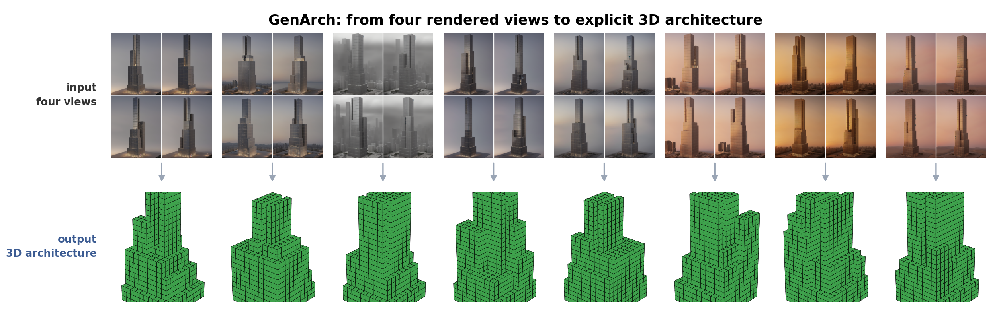
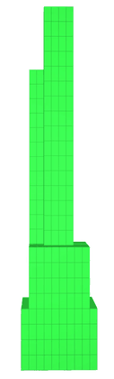
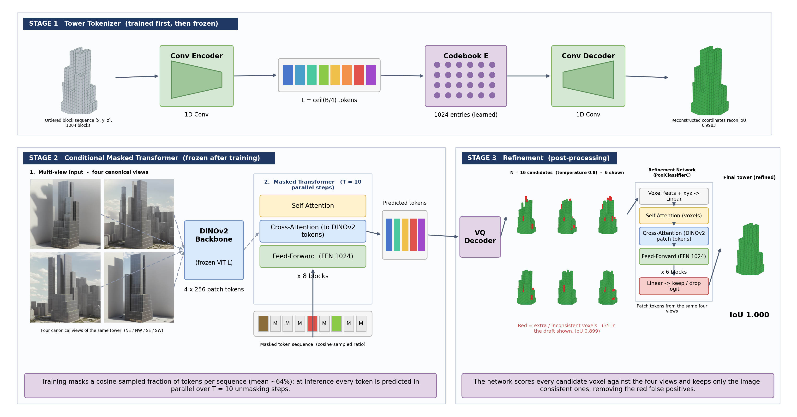
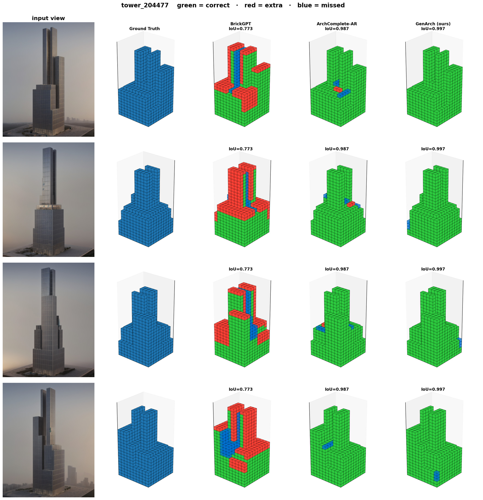

# GenArch

### Image-Conditioned Masked Generative Modelling of 3D Architectural Towers

Kunal Shah

*Paper and project page: coming soon.*

GenArch reconstructs an explicit 3D building from photographs. Give it four
views of a tower and it returns the block coordinates of that tower on a voxel
grid — in 0.23 seconds, at 0.995 IoU against ground truth.



<table>
<tr>
<td width="180"></td>
<td>

A generated tower, rendered turning. The output is not a mesh or a radiance
field — it is an ordered list of block centres on a fixed lattice, so it can be
edited, measured and built directly.

</td>
</tr>
</table>

## How it works

A tower is an ordered sequence of block coordinates. A 1D VQ-VAE compresses that
sequence into ~300 discrete tokens; a masked transformer predicts **all** tokens
in parallel from DINOv2 view features; a refinement network then merges sixteen
sampled candidates into one tower by scoring each candidate voxel against the
input images.



```
4 views ─► DINOv2 ViT-L patch tokens  (4 x 256 x 1024, cached)
        ─► masked transformer, N=16 parallel draws (temp 0.8)
        ─► whole-sequence VQ decode ─► grid snap
        ─► candidate pool (union of draws + 1-ring dilation)
        ─► refinement network (per-voxel keep/drop, tau 0.45)
        ─► final voxel set
```

The three stages are trained sequentially, each frozen before the next begins.

## Results

On the 40,000-tower validation set, all methods sharing the same four-view
DINOv2 conditioning:

| Method | steps | AITS (s) | IoU | %≥.99 | CD | F@0 |
|---|---:|---:|---:|---:|---:|---:|
| BrickGPT | ~11k | 108.4 | 0.7801 | 0.0 | 0.3111 | 0.8724 |
| ArchComplete-AR | 512 | 1.40 | 0.9865 | 48.8 | 0.0137 | 0.9932 |
| **GenArch** | **10** | **0.23** | **0.9950** | **85.1** | **0.0050** | **0.9975** |

The baselines' decoding steps are *sequential*; GenArch's 10 are *parallel* and
constant in tower size — hence 6.1x faster than the autoregressive baseline and
471x faster than the coordinate LLM, while also the most accurate.



<sub>Green = correct, red = predicted but absent, blue = missed. Four rows are
four input views of the same tower.</sub>

Each inference stage contributes:

| | single pass | vote (N=16) | + refinement |
|---|---:|---:|---:|
| IoU | 0.9802 | 0.9887 | **0.9950** |

Per-view training dropout makes the model degrade gracefully as views are
removed — 1/2/3/4 views give 0.892 / 0.961 / 0.986 / 0.995.

## Installation

This repo uses the Python project manager [uv](https://docs.astral.sh/uv/).

```bash
git clone https://github.com/<user>/genarch.git && cd genarch
uv sync                # core: tokenizer, transformer, refinement, eval
uv sync --extra viz    # + pyvista, imageio   (turntable renders)
```

Python ≥ 3.12, PyTorch ≥ 2.3, one CUDA GPU for training or evaluation.

### Prerequisites

**Checkpoints.** Three files, ~160 MB total, released alongside the paper. Place
them under `checkpoints/myarch/`:

| stage | path |
|---|---|
| tokenizer | `ibq_4x_nc1024_nq1/model/net_best_iou.tar` |
| masked transformer | `myarch_mask_img_patch_v8_2/model/net_best_iou.tar` |
| refinement | `pool_classifier/poolcls_c_sym_v1/best.tar` |

**Dataset.** The Gen3D tower dataset — 200,000 towers, four rendered views each.
See [`docs/DATASET.md`](docs/DATASET.md) for the layout, the grid convention and
how to build the converted form from the raw release.

**Paths.** Nothing is hardcoded. Point the code at your copies either through
environment variables or a `.genarch_paths` file at the repo root:

```
GENARCH_DATA_ROOT=/path/to/NewArchDataConverted
GENARCH_IMAGE_ROOT=/path/to/NewArchDataRaw
GENARCH_CHECKPOINTS=/path/to/checkpoints
```

Environment variables win over the file, which wins over repo-relative defaults.
A checkpoint's stored `data_root` never overrides a configured one.

## Running inference

### From raw images

Runs the full path — load four PNGs, encode them with DINOv2 live, generate,
decode, score:

```bash
uv run python script/eval_e2e_from_images.py --gpu_id 0 --n_towers 8
```

This is also the entry point for a tower the model has never seen: it takes the
four view PNGs from `$GENARCH_IMAGE_ROOT/<tower>/`, and the only ground-truth
input to generation is the token count (see *Notes* below). `--views 0 1 2 3 4`
sweeps how many views are supplied, zeroing the rest.

### The deployed pipeline

Single pass, 16-draw vote and refinement, with IoU / Chamfer / F-score and
per-tower timings:

```bash
uv run python script/eval_pipeline.py --split val40k --limit 200 --gpu_id 0
```

Expect roughly **single 0.974 / refined 0.991** on a 200-tower slice — a little
under the headline, as expected for a small sample. Drop `--limit` for the full
number, and shard it across GPUs with `--shard_idx i --num_shards N`, then
`--combine`.

### Rendering

```bash
uv run python script/gen_img_towers.py --num_towers 8 --gpu_id 0
uv run python script/gen_turntable_video.py --tower tower_101315   # needs --extra viz
```

## Training

Three stages, in order. Each script's docstring carries the exact deployed
recipe; `N` is your GPU count.

```bash
# 0. cache DINOv2 patch features (once per dataset, the expensive step)
uv run python script/preprocess/precompute_patch_dl.py --out_root $GENARCH_DATA_ROOT

# 1. tokenizer
uv run torchrun --nproc_per_node=N script/train_vq.py \
    --name <vq> --dataset_name myarch --quantizer ibq \
    --down_t 2 --stride_t 2 --window_size 64 --nb_code 1024

# 2. masked transformer
uv run torchrun --nproc_per_node=N script/train_transformer.py \
    --name <run> --vq_name <vq> --use_cls_prefix \
    --deterministic_crop --val_decode_mode whole \
    --coord_loss_weight 1.0 --ce_loss_weight 0.1 --view_drop_prob 0.2

# 3. refinement: cache candidate pools, then train
uv run python script/gen_pool_cache.py --split train160k
uv run python script/train_refinement.py --name <cls> --use_image
```

## Reproducing the paper

[`docs/REPRODUCE.md`](docs/REPRODUCE.md) gives every table, the command that
produces it, and the number to expect — the main comparison, the inference-stage
breakdown, the view ablation, the quantizer/objective study, decoding-iteration
and sampling sweeps, the training masking-ratio sweep, and inference timing.

## Notes

Four things that silently cost accuracy if you get them wrong:

- **Decode IBQ whole-sequence, residual VQ windowed (`w=64`).** Mixing them costs
  ~0.03 IoU on IBQ and collapses residual VQ to ~0.65.
- **Keep `cond_scale = 1.0`.** Classifier-free guidance was swept and is
  monotonically harmful here; voting degrades about twice as fast as single-pass
  under it.
- **The vote threshold is 0.4375** (≥7 of 16). The optimum rose from 0.3 as the
  sample pool got cleaner.
- **`generate()` needs a token count.** All reported numbers take it from ground
  truth. For fully image-only inference use the length predictor
  (`script/ablations/train_length_predictor.py`, MAE ~6.6 tokens) with symmetric
  length jitter across the 16 draws; expect ~0.980 rather than ~0.986.

The coordinate-dominant objective (`--coord_loss_weight 1.0 --ce_loss_weight 0.1`)
is not a detail: plain cross-entropy caps around 0.88, because codebook entries
are context-dependent synonyms and CE penalises every equivalent alternative.

Primary metric is voxel IoU, complemented by Chamfer distance and F-score.

## Repository layout

| path | contents |
|---|---|
| `models/vq/vqvae.py` | `VQVAE` — the tower tokenizer |
| `models/vq/quantizer.py` | `IBQQuantize`, `QuantizeEMAReset`, `QuantizerStack` |
| `models/vq/encdec.py`, `resnet.py` | 1D convolutional encoder / decoder |
| `models/mask_transformer/` | `MaskTransformer` and its trainer |
| `models/refinement.py` | `RefinementNetwork` — per-voxel keep/drop |
| `data/`, `options/`, `utils/` | datasets, CLI options, voxel + decode helpers |
| `script/` | training, evaluation, inference, figures |
| `script/preprocess/` | dataset conversion, feature precompute |
| `script/ablations/` | view ablations, decoding sweeps, timing |

## Citation

```bibtex
@misc{shah2026genarch,
  title  = {GenArch: Image-Conditioned Masked Generative Modelling of 3D Architectural Towers},
  author = {Shah, Kunal},
  year   = {2026}
}
```

## License

MIT — see [`LICENSE`](LICENSE).

## Acknowledgements

The masked-generation formulation follows the MaskGIT / MMM line of work. The
project was initially prototyped from
[MoMask](https://github.com/EricGuo5513/momask-codes). Conditioning uses frozen
[DINOv2](https://github.com/facebookresearch/dinov2) features; the tokenizer's
quantizer follows [IBQ](https://arxiv.org/abs/2412.02692).
